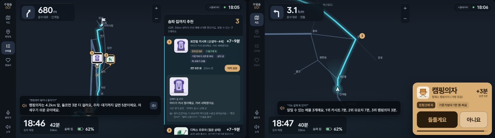
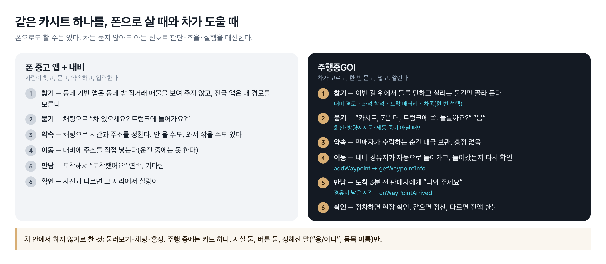
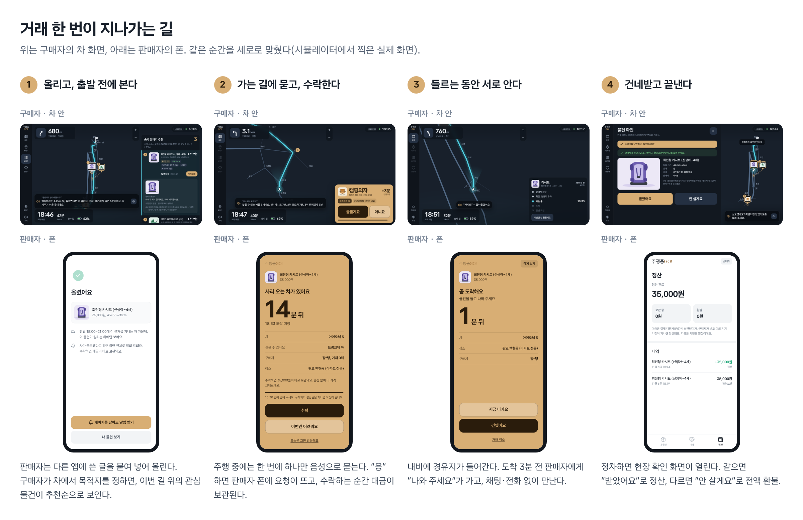
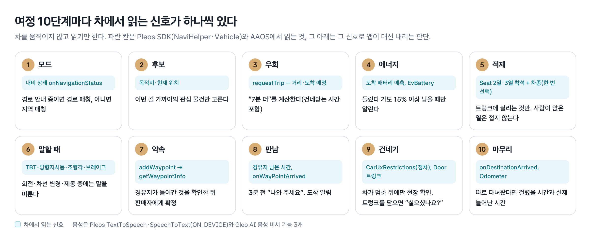
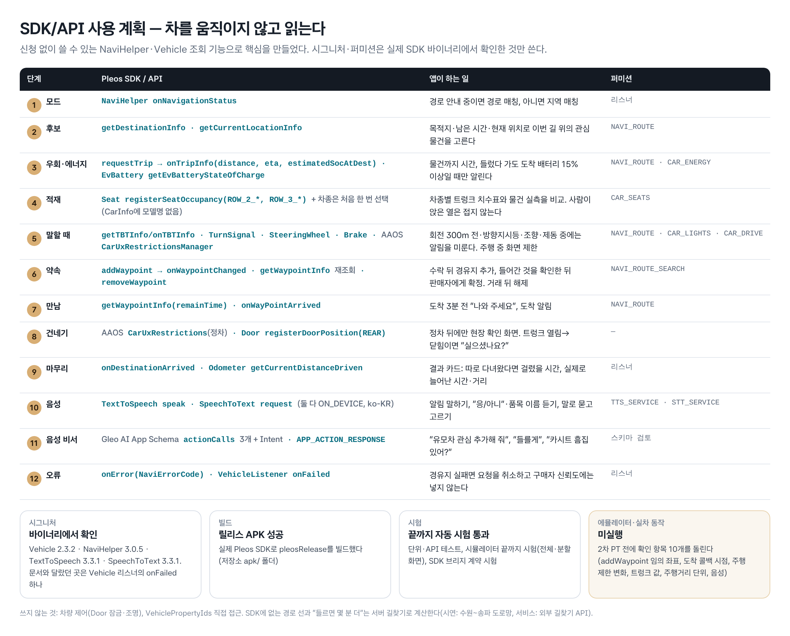
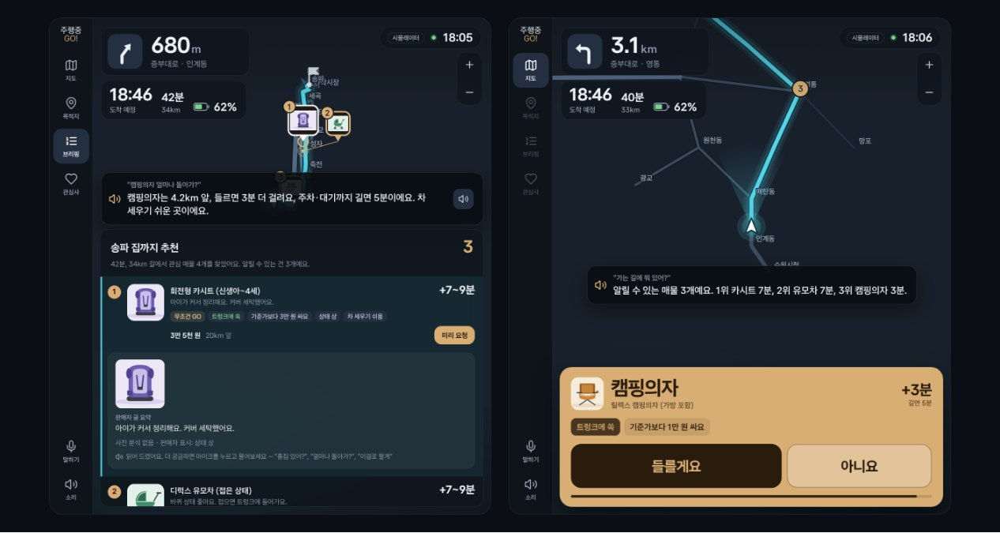
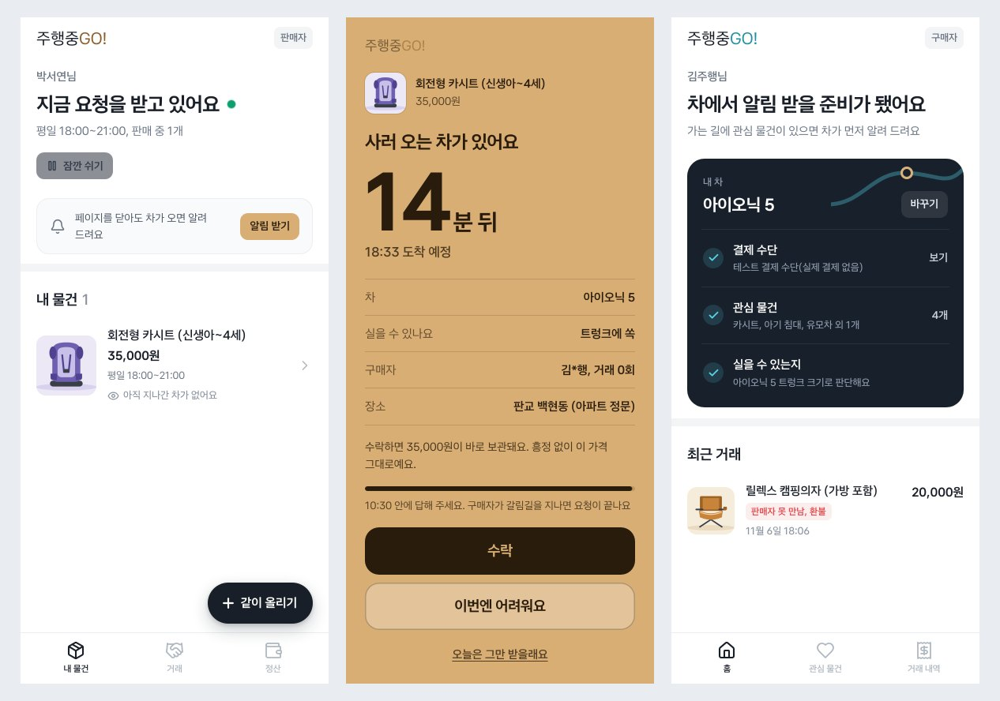

# 주행중GO!

**가는 길에, 한 번에 하나씩.** 찜해 둔 중고 물건이 오늘 운전하는 길 가까이에 올라와 있으면 차가 먼저 골라서 묻고, 판매자가 수락하면 내비 경유지로 넣어 들렀다 가게 하는 Pleos Connect 차량 앱.
구매자는 차 안에서(내비 화면), 판매자는 폰 웹에서 쓴다. 현대자동차그룹 차량용 앱 개발 공모전 출품작이다.



## 빠른 실행 (심사용)

| | |
|---|---|
| 앱 이름 | **주행중GO!** — 가는 길에, 한 번에 하나씩. Pleos 내비 경로 가까이 올라온 중고 물건을 차가 골라 묻고, 판매자가 수락하면 경유지로 넣어 들렀다 가는 차량 앱 |
| APK | [`apk/JHGO_주행중GO_release.apk`](apk/JHGO_주행중GO_release.apk) — pleosRelease, 실제 Pleos SDK로 빌드(약 29 MB) |
| 테스트 환경 | Pleos Connect Emulator 2.1.0 (Android API 34, Automotive) · Android Studio · 서버를 같이 쓸 때만 Node 22 |
| 시연 영상 | [`docs/video/jhgo-demo-3min.mp4`](docs/video/jhgo-demo-3min.mp4) — 약 3분, 화면 녹화·자막(1~8장면 브라우저 시뮬레이터, 9~10장면 실제 SDK 모드의 가짜 브리지) |
| 브라우저 체험 | `npm run build -w apps/demo` 뒤 `apps/demo/dist/index.html`을 연다 — 설치 없이 판매자 폰·차 화면·가상 콘솔이 한 페이지에서 움직이고, '자동 시연' 버튼을 누르면 7단계가 저절로 진행된다 |

**실행 방법 — 서버 없이 3단계**

1. Pleos Connect 에뮬레이터를 켠다(만드는 법: [`apps/car-android/README.md`](apps/car-android/README.md)).
2. `adb install -r apk/JHGO_주행중GO_release.apk` 로 설치하고 앱 '주행중GO!'를 연다.
3. 시작 화면에서 **자동 시연 보기**를 누른다 — 판매자가 물건을 올린 상태에서 출발 전 브리핑 → 주행 중 알림 → 경합("카시트? 유모차?") → 판매자 수락·경유지 → 만남·현장 확인 → 정산·평가까지 7단계가 2분 동안 저절로 진행된다.

시작 화면의 나머지 두 길:

- **실제 차 신호로 쓰기** — 앱 안의 차량 화면이 Pleos NaviHelper·Vehicle·TTS·STT 신호로 돈다(서버는 앱 안). 시연 매물이 수원~송파 도로망 위에 있어서, 에뮬레이터 위치를 수원시청 근처에 두고 Pleos 내비 목적지를 송파로 정하면 출발 전 브리핑이 열린다. 오른쪽 아래 'SDK 기록'에 호출·이벤트가 남는다.
- **서버에 연결** — PC에서 `npm install && npm run build:web && npm start` 뒤 주소(에뮬레이터에서 PC는 `http://10.0.2.2:8787`)를 넣는다. 판매자 폰(`/seller/`)·구매자 폰(`/buyer/`)과 같은 서버로 양쪽을 함께 시연할 때.

확인한 것과 아직 못 한 것: 실제 Pleos SDK로 릴리스 APK를 빌드했고, 단위·API 테스트 125개와 시뮬레이터 끝까지 시험(전체 화면·분할 화면), SDK 브리지 계약 시험, 자동 시연이 통과한다. **Pleos Connect 에뮬레이터·실차에서의 동작 확인은 아직 못 했다**([`docs/STATUS.md`](docs/STATUS.md)).

## 무엇을 푸는가

중고 거래에서 가장 비싼 것은 물건 값이 아니라 거래하러 가는 이동과 약속 조율이다. 큰 물건일수록 그렇다. 주행중GO!는 차가 이미 아는 신호로 '지금 들를 수 있고, 실을 수 있고, 갔다 와도 되는' 물건만 고르고, 말해도 되는 순간에만 한 번에 하나씩 묻는다.





## Pleos SDK를 어디에 쓰나

차를 움직이지 않고 읽기만 한다. 시그니처·퍼미션은 실제 SDK 바이너리에서 확인한 것만 쓴다(전체 판정표: [`docs/API_MATRIX.md`](docs/API_MATRIX.md)).





| 여정 | Pleos SDK / API | 쓰는 곳 |
|---|---|---|
| 모드·후보 | NaviHelper `onNavigationStatus`, `getDestinationInfo`, `getCurrentLocationInfo` | 경로 안내 중이면 경로 매칭, 아니면 지역 매칭 |
| 우회·에너지 | NaviHelper `requestTrip`(거리·도착 예정·도착 배터리), Vehicle EvBattery | "+7분", 들렀다 가도 배터리 15% 이상일 때만 |
| 적재 | Vehicle Seat 착석(2열·3열). 차종은 처음 한 번 고른다(CarInfo에 모델명이 없다) | 차종 트렁크 치수, 사람이 앉은 열은 접지 않음 |
| 말할 때 | NaviHelper TBT, Vehicle TurnSignal·SteeringWheel·Brake, AAOS CarUxRestrictions | 회전·방향지시등·조향·제동 중엔 알림을 미룸, 상세 화면은 정차 뒤 |
| 약속·만남 | NaviHelper `addWaypoint` → `getWaypointInfo` 재확인, `onWayPointArrived`, `onDestinationArrived` | 수락 뒤 경유지, 도착 3분 전 "나와 주세요", 도착 알림 |
| 음성 | TextToSpeech·SpeechToText(ON_DEVICE, ko-KR), Gleo AI App Schema 기능 3개 | 알림 말하기, "응/아니"·품목 듣기, 말로 묻고 고르기 |

## 화면

Pleos Connect UI 디자인 가이드에 맞췄다: 주행 중 카드는 1~2초에 읽히게 사실 둘·버튼 둘, 글꼴은 Pleos 기본 글꼴 Asta Sans, 글자 대비 4.5:1 이상. 다른 앱과 화면을 나눠 쓰는 분할 화면(1:1)에서는 지도가 위, 목록·알림 카드가 아래로 다시 배치된다(창의 가로÷세로가 1.45보다 작을 때. 시뮬레이터에서는 `/car/?split`).




쓰는 글꼴·아이콘·라이브러리의 라이선스는 [`THIRD_PARTY_NOTICES.md`](THIRD_PARTY_NOTICES.md).

## 문서

- 기획: `docs/01_기획서.md`(PDF는 `node node_modules/tsx/dist/cli.mjs tools/doc-pdf.ts docs/01_기획서.md <출력.pdf>`), 공식 접수 양식에 넣은 글: `docs/02_접수양식.md`(양식 채우기는 `tools/submission-form.py`), 설문 질문지: `docs/04_설문.md`, 결정과 공모전 정보: `docs/00_가이드.md`
- 기능별 구현 위치: `docs/TASKS.md`, 기획서 문장별 대조: `docs/SPEC_CHECK.md`, 현재 상태: `docs/STATUS.md`
- Pleos SDK 사용 현황: `docs/API_MATRIX.md`, 차량 앱 브리지: `docs/BRIDGE.md`
- 만든 것 전부 한 문서로: `docs/03_개발_정리.md`

## 구성

```
packages/core      매칭·경로·적재·에너지·알림 타이밍·개인화·거래 상태 머신 (UI 없음, 테스트)
services/api       서버(Hono) — Node에서는 SQLite, 브라우저에서는 메모리 저장소로 같은 코드가 돈다
apps/seller-web    판매자 폰 웹 (폰 화면 디자인 시스템 src/styles.css·kit.tsx, 웹 푸시 서비스 워커 public/sw.js)
apps/buyer-web     구매자 폰 웹 (내 차 준비 체크·관심 물건·거래 내역과 대금 흐름·평가·현장 사진)
apps/car-web       차량 화면(내비) + 브라우저 시뮬레이터·가상 콘솔 + Pleos SDK 포트
apps/car-android   차량 앱 셸(WebView + Pleos SDK 브리지, Kotlin)
apps/demo          체험 페이지(두 앱 + 페이지 안 서버, 한 파일)
tools              E2E·브리지 계약 시험·시연 영상·문서 그림(doc-figs)·접수 양식 채우기(submission-form)
```

## 실행 (Node 22 이상)

```bash
npm install
npm run build:web      # 판매자 웹·구매자 웹·차량 화면 빌드
npm start              # http://localhost:8787
```

- 차량 화면: http://localhost:8787/car/ — 아래 가상 콘솔로 기어·배속·좌석·방향지시등·배터리·트렁크를 바꾸고, 알림이 뜨면 '음성 대답' 버튼이 마이크를 대신한다. `/car/?device`면 실기기처럼 창을 가득 채운다(1920×720 같은 넓은 화면, 창을 세로로 줄이면 분할 화면 배치). `/car/?split`은 가상 콘솔을 둔 채 차 화면만 분할 화면(8:9 창)으로 보여 준다
- 판매자 폰: http://localhost:8787/seller/ — 폰으로는 같은 와이파이에서 서버가 찍어 주는 `http://<PC IP>:8787/seller/`
- 구매자 폰: http://localhost:8787/buyer/ — 차와 같은 구매자 계정(시연: 김주행)
- 에뮬레이터 안 차량 앱에서는 PC가 `http://10.0.2.2:8787`
- 시연 시계는 2026-11-06(금) 18:05에서 시작한다. 콘솔의 '시연 처음으로'가 데이터와 시계를 처음으로 돌린다.
- 서버 없이: `/car/?local`(차량만, 페이지 안 서버) 또는 체험 페이지(`npm run build -w apps/demo` → `apps/demo/dist/index.html`). 체험 페이지의 '자동 시연' 버튼(`?auto`)은 7단계를 2분 동안 저절로 진행한다

시연 순서(약 3분): 차 화면 '목적지' → 송파 집(지도 번호 핀 + 추천 목록, 판매자 폰엔 '지나간 차 1대') → 콘솔 '2열 착석'·10×·D 주행 → 영통 캠핑의자 알림 → 분당 카시트·유모차 경합 → 카시트 '들를게요' → 판매자 폰 '수락' → 도착 3분 전 판매자 만남 화면 '지금 나가요'(차에 '판매자가 나오고 있어요') → 경유지 도착 → 판매자 '건넸어요' → 차 '받았어요' → D 주행 → 결과 카드에서 판매자 평가. 시간이 남으면 구매자 폰(결제 수단·거래 내역)과 '판매자가 안 나올 때'(자동 수락인 캠핑의자로 들러서 다시 알리기 → 5분 뒤 끝내기).

트렁크 열림·닫힘('실으셨나요?')은 Vehicle Door(REAR) 위치 리스너로 연결했지만, 열림 판정 값은 에뮬레이터에서 확인하기 전이다. 그래서 시연 순서에는 넣지 않는다.

## 폰 화면

판매자·구매자 폰은 같은 디자인 시스템(`apps/seller-web/src/styles.css`, 조각은 `kit.tsx`)을 쓴다. 흰 바탕과 굵은 문장으로 조용하게 두고, 크라프트는 차가 오는 순간(요청·만남 전체 화면)에만 쓴다.

- 글꼴: 앱 글꼴(CSS 이름 `JHGO Sans`)은 Asta Sans(`apps/seller-web/src/assets/AstaSans-subset.woff2`) — Pleos Connect UI 가이드의 기본 글꼴을 앱 글자와 KS X 1001 한글 2,350자로 줄인 부분집합(OFL 1.1, `AstaSans-OFL.txt`). 상표 글자 '주행중GO!'만 도현.
- 아이콘: lucide-react 0.469.0. 매물 사진 자리: `packages/core/src/art.ts`의 평면 물건 그림(실제 사진이 아니라는 게 보이게).
- 화면 문장에는 조사를 `josa()`로 붙이고, 한국어 줄바꿈은 `word-break: keep-all`.

## 웹 푸시 (판매자 폰)

판매자는 페이지를 닫아 둬도 '사러 오는 차가 있어요'를 받는다. 서비스 워커는 HTTPS(또는 localhost)에서만 돌아서, 폰에서는 HTTPS 주소로 열어야 한다.

- 가장 쉬운 길: PC에서 `cloudflared tunnel --url http://localhost:8787`처럼 HTTPS 터널을 열고, 폰에서 그 주소의 `/seller/`를 연다.
- 인증서가 있으면: `JHGO_TLS_CERT=cert.pem JHGO_TLS_KEY=key.pem npm start` → `https://<PC IP>:8787/seller/` (폰이 그 인증서를 믿어야 한다).
- 폰에서 내 물건(또는 거래) 탭 '알림 받기' → 권한 허용. 아이폰은 공유 → 홈 화면에 추가한 뒤 그 아이콘으로 열어야 받는다.
- 키(VAPID)는 처음 켤 때 만들어 저장소에 둔다(시연 초기화에도 남는다). `JHGO_VAPID_SUBJECT`로 연락처를, `JHGO_PUSH=0`으로 끄기.

## 사진으로 크기 추정, 물건 요약 브리핑

`ANTHROPIC_API_KEY=... npm start`로 켜면 판매자가 고른 사진(JPEG·PNG·WebP)으로 Claude가 품목과 크기를 추정한다(`JHGO_AI_MODEL`, 기본 `claude-haiku-5-5`). 키가 없거나 추정에 실패하면 품목 대표 크기로 채우고 화면에 '품목 기본 크기'라고 쓴다. 큰 물건은 어느 쪽이든 판매자 실측 확인이 있어야 올라간다.
같은 키로 '대화로 고르기'(T34) 조수도 Claude가 맡는다 — 레일 '말하기'를 누르고 "카시트 흠집 있어?", "둘 중에 뭐가 더 싸?", "유모차로 할게"라고 하면 지금 목록의 사실로만 답하고 요청·고르기·거절을 한다. 키가 없으면 같은 모양의 규칙 조수가 답한다(화면에 '규칙' 표시). 시뮬레이터에서는 가상 콘솔 '말하기' 입력이 마이크를 대신한다.
같은 키로 매물마다 물건 요약 브리핑도 만든다(T33): 판매자 글 요약 + 사진(최대 3장)에서 보이는 흠집·손상 항목. 차 목록에서 고르면 정차 중엔 카드, 주행 중엔 바로 읽어 준다. 키가 없으면 글 요약만 규칙으로 만들고 화면에 '사진 분석 없음'이라고 쓴다.

## 확인

```bash
npm test               # 단위·API 테스트
npm run typecheck
npm run e2e            # 판매자 폰 + 차량 화면 끝까지(스크린샷: tools/out/)
npm run e2e:split      # 같은 흐름을 분할 화면 배치(/car/?split)로 — 단추가 가려지면 실패한다(스크린샷: tools/out/split-*.png)
npm run e2e:bridge     # 차량 화면이 실제 SDK 모드(브리지)로 끝까지 도는지
npm run e2e:auto       # 체험 페이지 '자동 시연'(?auto)이 7단계를 끝까지 저절로 가는지(빌드한 jhgo-demo.html, 약 2분)
```

E2E 네 가지는 Playwright가 필요하다(package.json에 넣지 않았다 — 개발 환경에 설치된 판을 쓴다). 처음 받은 PC라면 `npm i --no-save playwright@1.56.0 && npx playwright install chromium`. 시연 영상 자르기·잇기에는 ffmpeg가 필요하다. GitHub에 올리면 `.github/workflows/ci.yml`이 같은 확인을 돌린다(테스트·타입·빌드 → E2E·브리지·자동 시연, 체험 페이지 파일과 스크린샷을 아티팩트로).

## 시연 영상

Playwright로 녹화하고 ffmpeg로 장면마다 자른다(ffmpeg 필요). 녹화 프레임이 밀려도 장면 경계가 맞게, 장면이 바뀔 때 화면 아래 색 띠를 바꾸고 영상에서 그 색을 찾는다(`tools/video-cut.ts`).

```bash
npm run build -w apps/demo
node node_modules/tsx/dist/cli.mjs tools/record-demo.ts <출력 폴더>      # 체험 페이지 → 01~08 MP4·대표 이미지(경합은 콘솔 '음성 대답'으로 고른다)
JHGO_RECORD=<출력 폴더> npm run e2e:bridge                               # 실제 SDK 모드(가짜 브리지) → 09~10
node node_modules/tsx/dist/cli.mjs tools/video-stitch.ts <클립 폴더> <출력 mp4>   # 01~10을 제목 카드와 이어 제출용 한 편(약 3분, 무음)
node node_modules/tsx/dist/cli.mjs tools/video-short.ts <클립 폴더> <출력 mp4>    # 숏폼(세로 1080×1920, 약 55초) — 차 화면·판매자 폰을 위아래로
```

- `JHGO_FONTS=<node_modules/@fontsource 폴더>`: 상표 글꼴 do-hyeon을 녹화 페이지에 넣는다(웹 글꼴을 못 받는 환경용). 본문 글꼴 JHGO Sans는 차·폰 화면 번들 안에 들어 있다.
- `JHGO_RECORD_ORIGIN=<정적 서버>`: `/car/`(차량 화면 빌드)와 `/fonts/<글꼴>/<굵기>.css`를 내주는 서버에서 차 화면을 열어 같은 글꼴로 녹화한다. 없으면 API 서버의 `/car/`를 그대로 녹화한다.

## 차량 앱(Android)

`apps/car-android/README.md`. Pleos Connect 에뮬레이터에서 PC 서버의 차량 화면을 띄우고 실제 NaviHelper·Vehicle·TextToSpeech·SpeechToText SDK를 부른다(음성은 둘 다 ON_DEVICE, 안 되면 안드로이드 표준으로 내려감). Gleo AI 음성 비서가 앱 기능 세 개(`assets/schema.json`: 관심 추가·알림 답하기·매물에 대해 묻기)를 부를 수 있고, 시뮬레이터에서는 가상 콘솔 'Gleo AI 음성 기능'으로 같은 호출을 흉내 낸다(`docs/BRIDGE.md`).

## 테스트 환경과 제출용 APK

- 개발·확인: Node 22, npm 10. 차 화면·폰 웹은 Chromium 계열 브라우저(E2E는 Playwright 1.56 Chromium). 서버는 `npm start`(기본 8787, SQLite `data/`), 체험 페이지는 서버 없이 한 파일.
- 차량 앱 빌드: Android Studio(AGP 8.7.3, Kotlin 2.0.21, API 34, JBR 21) + Pleos SDK Maven(`nexus-playground.pleos.ai`, 계정 없이). `apps/car-android/build.bat`(demo·pleos 디버그), `install.bat`(에뮬레이터 설치·실행), `release.bat`(제출용 APK). 2026-11-04 실제 SDK로 빌드 성공. 에뮬레이터: Pleos Connect Emulator(2.1.0, API 34) + Virtual Console — 만드는 법은 `apps/car-android/README.md`. 앱 안 '연결 설정'에서 PC 서버 주소(기본 `http://10.0.2.2:8787`)를 바꾼다.
- 폰: 같은 와이파이에서 `http://<PC IP>:8787/seller/`·`/buyer/`. 웹 푸시는 HTTPS 주소에서만.
- 공모전 제출용 APK: `release.bat`이 `apk/juhaengjung-go_pleos_release.apk`(약 29 MB, pleosRelease, debug 키 서명. 빌드 결과라 git이 무시한다)를 만든다. 제출하는 것만 `apk/JHGO_주행중GO_release.apk`로 복사해 커밋한다(GitHub 100 MB 한도 안).
- 문서에 넣는 그림: `npm run e2e && npm run e2e:split` 뒤 `node tools/doc-figs.cjs`(→ `docs/img/`). 공식 접수 양식 채우기: `python3 tools/submission-form.py --form <받은 양식.docx> --out <채운 양식.docx>` — 02장의 칸은 `docs/02_접수양식.md`에서, 별지 그림은 `docs/img/fig*.png`에서 온다. 신청자 정보와 양식 파일은 저장소에 두지 않는다.
